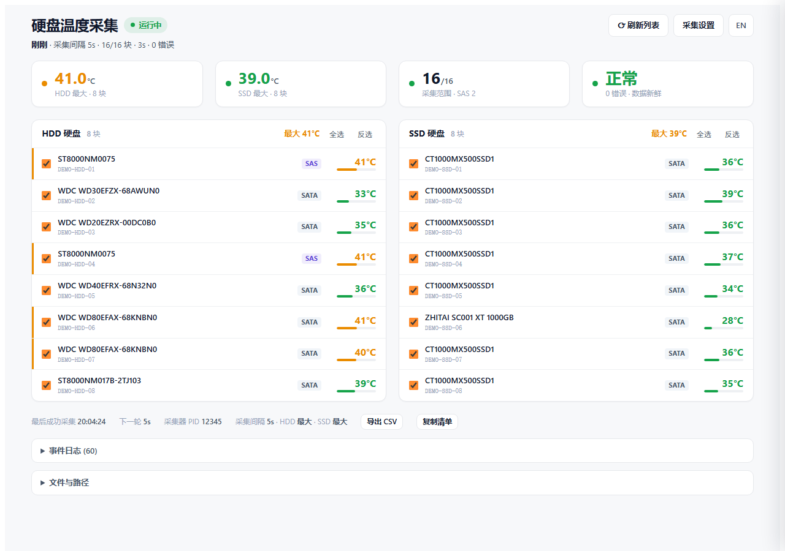

# cooler-hddtemp — HDD/SSD temperature collector for Unraid + CoolerControl

[](LICENSE)
[](https://unraid.net)

An Unraid plugin that reads drive temperatures with `smartctl` and publishes them as
**millidegree files** that [CoolerControl](https://coolercontrol.org/) can consume as
*custom file sensors* — so your case fans can follow **HDD/SSD temperature**, which
CoolerControl cannot read by itself (drives have no usable `hwmon` node).

> 中文说明见 [README.zh-CN.md](README.zh-CN.md)



## Why

CoolerControl builds fan curves from `hwmon` sensors. Drives exposed through HBA/SATA
don't provide one, so HDD/SSD temperature is invisible to it. This plugin:

1. scans every drive with `smartctl -iA`,
2. aggregates per group (HDD / SSD) using **max** or **avg**,
3. writes `41000` (= 41.0 °C) into two files every few seconds,
4. CoolerControl reads them as `File` custom sensors → your curves can use them.

## Features

- **Max or average** aggregation, independently for HDD and SSD
- **Hot-reload**: saving settings never restarts the collector (the collector re-reads
  `settings.cfg` every round) — no data gap, no fan blip
- **Atomic config write** (`tmp` → JSON validate → `rename`) so a half-written file can
  never be parsed as 0 drives
- **Dual-pane UI**: all HDDs on the left, all SSDs on the right, everything on one screen
  (tested at 1024 / 1280 / 1920 / 2560 / 3840 px)
- **Bilingual UI** (中文 / English) via cookie
- **Auto-add new drives** (opt-in): every 60 s the collector compares the smartctl scan with the saved list and adopts drives that appeared — HDD/SSD is decided by smartctl, SAS counts as HDD. Ideal after replacing a disk.
- **Configurable warn/hot thresholds** — colours and log hints only; **they do not touch fans**
- **Self-test script** (`bin/selftest.sh`) with 18 read-only checks, or 34 including
  destructive fail-safe tests
- No daemon, no database, no dependencies beyond `smartctl` / `perl` / `php` (all stock on Unraid)

## Requirements

| Component | Version / notes |
|---|---|
| Unraid | 7.0+ (page header uses `Menu="Utilities"`) |
| CoolerControl | 4.x/5.x, container or bare metal — only needed if you want fan curves |
| `smartctl` | shipped with Unraid |
| `php` | on the Unraid host (used by the page and `lib/*.php`) |

## Install (manual — recommended, tested)

`/boot` is your flash device. Copy the plugin there, then into RAM:

```bash
# 1) get the sources
git clone https://github.com/isping7/unraid-coolercontrol-hddtemp.git
# 2) install into /boot (persistent)
mkdir -p /boot/config/plugins/cooler-hddtemp
cp -r unraid-coolercontrol-hddtemp/plugin/* /boot/config/plugins/cooler-hddtemp/
```

Restore the page into RAM (survives until reboot):

```bash
mkdir -p /usr/local/emhttp/plugins/cooler-hddtemp/assets
cp /boot/config/plugins/cooler-hddtemp/cooler-hddtemp.page \
   /boot/config/plugins/cooler-hddtemp/cooler-hddtemp-en.page \
   /usr/local/emhttp/plugins/cooler-hddtemp/
cp /boot/config/plugins/cooler-hddtemp/assets/* \
   /usr/local/emhttp/plugins/cooler-hddtemp/assets/
```

Make that survive reboots by appending to `/boot/config/go` (before the emhttp line is fine):

```bash
cp /boot/config/plugins/cooler-hddtemp/cooler-hddtemp.page /usr/local/emhttp/plugins/cooler-hddtemp/
cp /boot/config/plugins/cooler-hddtemp/cooler-hddtemp-en.page /usr/local/emhttp/plugins/cooler-hddtemp/
mkdir -p /usr/local/emhttp/plugins/cooler-hddtemp/assets
cp /boot/config/plugins/cooler-hddtemp/assets/cct.css /boot/config/plugins/cooler-hddtemp/assets/cct.js /usr/local/emhttp/plugins/cooler-hddtemp/assets/
```

> **Betas/`.plg`**: an installable `.plg` is provided under `unraid/` but has **not** been
> validated on a clean Unraid system yet. The manual steps above are the tested path.

## Start the collector at array start

Do **not** start it from `/boot/config/go`: at that point `/mnt/user` is not mounted yet,
so writes to the temperature files would fail. Use the **User Scripts** plugin:

1. Settings → User Scripts → *Add New Script*, name it `start-cooler-hddtemp`
2. Schedule: **At Startup of Array**
3. Content:

```bash
#!/bin/bash
P=/boot/config/plugins/cooler-hddtemp/scripts/collector.sh
PIDF=/tmp/cooler-hddtemp.pid
# wait for appdata to become writable (array not fully mounted at boot)
for i in $(seq 1 12); do [ -w /mnt/user/appdata/coolercontrol ] && break; sleep 5; done
[ -f "$PIDF" ] && kill -0 "$(cat $PIDF)" 2>/dev/null && exit 0
nohup bash "$P" >/dev/null 2>&1 &
echo $! > "$PIDF"
exit 0
```

Optionally add a second script scheduled **At Stopping of Array** that runs
`pkill -f 'cooler-hddtemp/scripts/collector.sh'` — otherwise the collector keeps writing
into an array that is being unmounted.

## Configure

Open **Settings → Utilities → 硬盘温度采集** (Drive Temperature). The settings drawer holds:

| Field | Default | Meaning |
|---|---|---|
| Interval | 5 s | 5–60 s between rounds |
| HDD / SSD aggregation | avg / avg | `max` (hottest drive) or `avg` |
| Warn / Hot | 40 / 50 °C | UI colours + log warnings only |
| Scope | all | untick a drive to exclude it (at least one must stay) |
| Auto-add new drives | off | adopt drives found by the scan but missing from the list; **overrides manual exclusions** |

Config file: `/boot/config/plugins/cooler-hddtemp/settings.cfg` (see
`unraid/settings.example.cfg`). Temperature files:

```
/mnt/user/appdata/coolercontrol/hdd_temp    →  e.g. 41000
/mnt/user/appdata/coolercontrol/ssd_temp    →  e.g. 39000
```

Values are **millidegrees Celsius** (41000 = 41.0 °C), plain integer, no newline issues —
this is exactly the format CoolerControl's `File` sensor expects.

## CoolerControl setup

1. CoolerControl → *Sensors* → **Add custom sensor** → type `File`
   - Name: `HDD Temp`, path: `/etc/coolercontrol/hdd_temp`
   - (container must mount `/mnt/user/appdata/coolercontrol` at `/etc/coolercontrol`)
2. Repeat for `ssd_temp`
3. Edit your fan curve profile → *Temperature source* → pick the file sensor
4. Save; the daemon picks it up immediately

> Do **not** hand-edit `[[custom_sensors]]` in `config.toml` — the config loader rejects
> hand-written blocks (upstream issue #604). Use the WebUI.

## How it works

```
User Scripts (array start) → collector.sh (bash, one process)
    every round:
      read settings.cfg  →  smartctl -iA per drive  →  aggregate  →  write hdd_temp / ssd_temp
                                                                 →  write status.json (RAM)
CoolerControl: reads the two files every second → curve → PWM → fans
WebUI: polls status.json, renders the dual-pane tables
```

Design notes and the module split are documented in [docs/ARCHITECTURE.md](docs/ARCHITECTURE.md).

## Self-test

```bash
bash /boot/config/plugins/cooler-hddtemp/bin/selftest.sh            # 18 read-only checks, ~5 s
bash /boot/config/plugins/cooler-hddtemp/bin/selftest.sh --full --yes   # 34 checks, ~2 min
```

`--full` stops the collector, injects temperatures, deletes the file, restarts the
container — **fans will briefly hit 100 %** during the fail-safe checks. The script traps
exits and restores config, temperature files, and the running collector.

## Troubleshooting

| Symptom | Cause | Fix |
|---|---|---|
| Page missing from Settings menu | CRLF line endings broke the `.page` header split | `sed -i 's/\r$//' <page>` then re-copy; check `grep 'Invalid .page' /var/log/syslog` |
| Temperature file frozen | collector died | `php /boot/config/plugins/cooler-hddtemp/lib/control.php status` then `start` |
| Fans stuck at last speed | collector dead → file readable but stale; CoolerControl only detects *unreadable* files | the UI shows a "stale" badge; restart the collector |
| Fans 100 % for ~9 s | file missing/invalid → CoolerControl fail-safe | expected behaviour, restores ~4 s after the file returns |
| 0 drives per round | config has an empty `d[]`, or half-written JSON | save again from the UI (it rejects empty selection) |
| Page unstyled | `assets/` not copied to RAM | re-run the `cp` lines / check `/boot/config/go` |

## Safety notes

- Aggregation `max` follows the **hottest** drive — with big arrays this can raise fan speed
  noticeably, especially for SSDs (a 41 °C SSD sits high on a typical curve).
- The plugin only **reads** temperatures. Every fan decision is made by CoolerControl.
- The collector writes the temperature files non-atomically on purpose: CoolerControl keeps
  the last good value and only fails over after 8 consecutive read errors.

## License

MIT — see [LICENSE](LICENSE).

CoolerControl is a separate project (GPL-3.0) by the CoolerControl authors; this plugin
merely writes files it can read.
