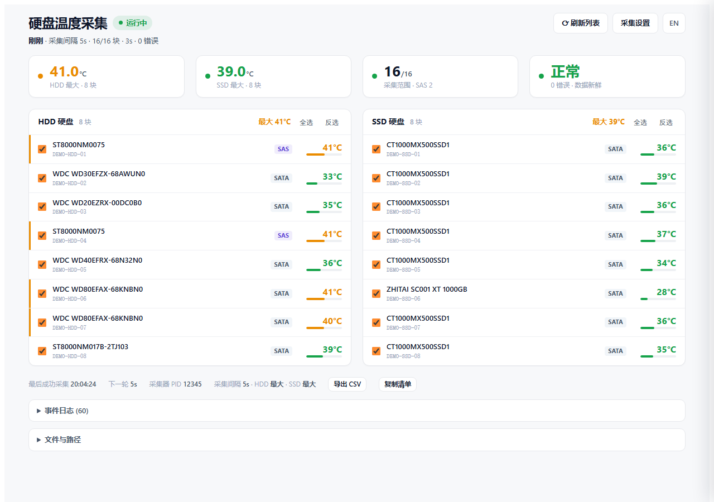

# cooler-hddtemp — Unraid 硬盘温度采集（配合 CoolerControl）

[](LICENSE)

用 `smartctl` 采集每块硬盘的温度，按 HDD / SSD 分组聚合后，以**毫摄氏度**写入两个文件，
供 [CoolerControl](https://coolercontrol.org/) 当作「文件传感器」读取——这样风扇曲线就能
跟着**硬盘温度**走。硬盘本身没有可用的 `hwmon` 节点，CoolerControl 自己是读不到的。

> English: [README.md](README.md)



## 解决什么问题

CoolerControl 的曲线只能吃 `hwmon` 传感器，走 HBA/SATA 的硬盘没有这个节点，所以硬盘温度
对它不可见。本插件：

1. 用 `smartctl -iA` 逐盘取温度；
2. 按组聚合（`max` 取最热、`avg` 取平均）；
3. 每隔几秒把 `41000`（= 41.0°C）写进两个文件；
4. CoolerControl 建 `File` 自定义传感器读取 → 曲线可用。

## 特性

- HDD / SSD **分别**选择「最大值 / 平均值」
- **保存即热生效**：保存配置不重启采集器（它每轮重读 `settings.cfg`），无数据空窗、风扇不抖
- **原子写配置**（`tmp` → JSON 校验 → `rename`），半截文件永远不会被读成 0 块盘
- **双栏界面**：左边全部 HDD、右边全部 SSD，一屏看全（实测 1024/1280/1920/2560/3840）
- **中英双语**，cookie 记忆
- **告警/高温阈值可配**——只影响颜色和日志，**不控制风扇**
- **自带自检脚本**：18 项只读检查，或 34 项含破坏性用例
- 无常驻守护、无数据库，只依赖 Unraid 自带的 `smartctl` / `perl` / `php`

## 安装（手动，已实测）

```bash
# 1) 取源码
git clone https://github.com/isping7/unraid-coolercontrol-hddtemp.git
# 2) 装进 /boot（持久）
mkdir -p /boot/config/plugins/cooler-hddtemp
cp -r unraid-coolercontrol-hddtemp/plugin/* /boot/config/plugins/cooler-hddtemp/
```

再把上面 `cp` 的几行（含 `mkdir`）追加到 `/boot/config/go`，重启后页面才不会丢。
`unraid/` 下有一个 `.plg`，但**尚未在全新 Unraid 上验证**，建议先用手动方式。

**注意**：文件必须是 LF 行尾。CRLF 会让 emhttp 的 `.page` 头部解析失败，页面直接从设置菜单消失
（syslog 里会出现 `Invalid .page format`）。

## 采集器自启

**不要**写在 `/boot/config/go` 里——那时 `/mnt/user` 还没挂载，写温度文件会失败。
用 **User Scripts** 插件，新建脚本，频率选 **At Startup of Array**：

```bash
#!/bin/bash
P=/boot/config/plugins/cooler-hddtemp/scripts/collector.sh
PIDF=/tmp/cooler-hddtemp.pid
for i in $(seq 1 12); do [ -w /mnt/user/appdata/coolercontrol ] && break; sleep 5; done
[ -f "$PIDF" ] && kill -0 "$(cat $PIDF)" 2>/dev/null && exit 0
nohup bash "$P" >/dev/null 2>&1 &
echo $! > "$PIDF"
exit 0
```

建议再加一个 **At Stopping of Array** 的脚本：`pkill -f 'cooler-hddtemp/scripts/collector.sh'`。

## 配置

设置 → 实用工具 → **硬盘温度采集**。抽屉里可调：采集间隔（5–60 秒）、HDD/SSD 取值方式、
告警/高温阈值、采集范围（取消勾选即排除，至少保留 1 块）。

输出文件（毫摄氏度）：

```
/mnt/user/appdata/coolercontrol/hdd_temp    例：41000
/mnt/user/appdata/coolercontrol/ssd_temp    例：39000
```

## CoolerControl 侧

1. Sensors → 新建自定义传感器 → 类型 `File`，路径 `/etc/coolercontrol/hdd_temp`（SSD 同理）
2. 编辑风扇曲线的温度来源，选这两个传感器
3. 不要手改 `config.toml` 里的 `[[custom_sensors]]`（上游 #604 会拒绝），一律用 WebUI

## 自检

```bash
bash /boot/config/plugins/cooler-hddtemp/bin/selftest.sh                # 18 项只读，约 5 秒
bash /boot/config/plugins/cooler-hddtemp/bin/selftest.sh --full --yes   # 34 项，约 2 分钟
```

`--full` 会停采集器、注入温度、删文件、重启容器，**期间风扇会短时全速**；
脚本用 `trap` 兜底，退出时恢复配置与温度文件并确保采集器在跑。

## 已知问题

| 现象 | 原因 | 处理 |
|---|---|---|
| 设置里找不到入口 | CRLF 破坏了 `.page` 头部 | `sed -i 's/\r$//'` 后重新 `cp`；查 `grep 'Invalid .page' /var/log/syslog` |
| 温度文件不动 | 采集器死了 | `php …/lib/control.php status`，再 `start` |
| 风扇停在某个转速不降 | 采集器死了但文件还可读，CoolerControl 只认「读不到」 | 页面会显示「数据陈旧」；重启采集器 |
| 风扇 100% 约 9 秒 | 文件缺失/非法触发 fail-safe | 正常行为，文件恢复后约 4 秒回落 |
| 每轮 0 块盘 | 配置里盘列表为空，或写了一半的 JSON | 在页面重新保存（空选会被拒绝） |
| 页面没样式 | `assets/` 没复制到 RAM | 重跑 `cp`，检查 `/boot/config/go` |

## 安全说明

- 选 `max` 时跟的是**最热那块盘**，大盘阵下风扇会比 `avg` 积极（SSD 尤其明显）。
- 插件只**读取**温度，所有风扇决策都在 CoolerControl 里做。

## 许可

MIT，见 [LICENSE](LICENSE)。CoolerControl 是独立项目（GPL-3.0），本插件只是写它可读的文件。
